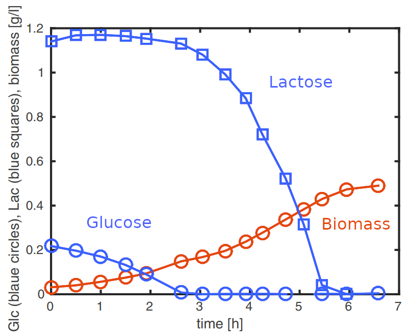
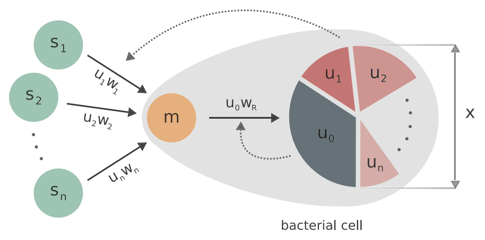

# Predicting diauxic growth as an optimal control problem

When bacteria grow in an environment containing several carbon sources, they may not consume them simultaneously. Instead, they first use the preferred substrate and only switch to the next one once the first is depleted. This sequential behaviour, first described by Jacques Monod in the 1940s with *Escherichia coli* growing on glucose and lactose, is known as **diauxic growth**.

```@raw html

```

Experimental data of *E. coli* exhibiting diauxic growth on glucose and lactose [^2]. Figure adapted from [^1].

From a modelling perspective, diauxie can be understood as a **resource allocation problem**: at each instant, the cell has to decide how to distribute its limited resources between the enzymes needed to take up and metabolise each substrate and the machinery responsible for growth (ribosomes). Within this framework, it is natural to ask whether the sequential consumption observed experimentally can be recovered as the solution of an optimal control problem, in which the cell allocates its resources so as to maximize its biomass at the end of the experiment.

This is the question addressed in [^3] [^4], whose numerical results are reproduced here using the Julia package [`OptimalControl.jl`](https://control-toolbox.org/OptimalControl.jl/stable).

## Mathematical framework

### Dynamical model

The mathematical model describes the time-evolution of the concentration of the *i*-th substrate sᵢ(t), the concentration of intermediate metabolites m(t), and the volume of the cell population x(t). The dynamical system can be written as:

```math
\begin{cases}
\dot{s}_i = -w_i(s_i)\mathcal{x}, \quad i = 1, 2, \ldots, n \\
\dot{m} = \sum_{i=1}^{n} Y_i w_i(s_i) - w_R(m)(m+1) \\
\dot{\mathcal{x}} = w_R(m)\mathcal{x}
\end{cases}
```

The function wᵢ(sᵢ) is the uptake rate of the *i*-th substrate, which is converted into intermediate metabolites with yield coefficient Yᵢ ∈ (0, 1], while ``w_R(m)`` is the rate at which intermediate metabolites are used to synthesize proteins and thus produce biomass. The term (m + 1) accounts both for this consumption and for the dilution of the metabolites due to growth. The rate functions are non-dimensional, null at the origin, strictly increasing, strictly concave and saturate at 1.

### Optimal control formulation

Following the resource allocation viewpoint, the proteins of the cell involved in growth are split between the metabolic machinery (enzymes responsible for substrate uptake and metabolite synthesis) and the gene expression machinery (ribosomes responsible for protein synthesis). This distribution is modelled through control variables: u₀(t) is the fraction allocated to ribosomes, while uᵢ(t), for i = 1, …, n, is the fraction allocated to the enzymes metabolizing the *i*-th substrate.

```@raw html

```

Scheme of the resource allocation model. Each external substrate sᵢ is metabolized into intermediate metabolites, which are then used to synthesize proteins. Metabolic proteins catalyze the uptake of nutrients (upper dotted line), while ribosomes catalyze the synthesis of proteins (lower dotted line). Figure taken from [^4].

Since all these proteins come from the same limited pool, the controls satisfy:

```math
\begin{aligned}
& u_i(t) \in [0, 1], \quad i = 0, 1, \ldots, n, \\
& \sum_{i=0}^{n} u_i(t) \leq 1.
\end{aligned}
```

The controlled model then reads:

```math
\begin{cases}
\dot{s}_i = -u_i w_i(s_i)\mathcal{x}, \quad i = 1, 2, \ldots, n \\
\dot{m} = \sum_{i=1}^{n} Y_i u_i w_i(s_i) - u_0 w_R(m)(m+1) \\
\dot{\mathcal{x}} = u_0 w_R(m)\mathcal{x}
\end{cases} \tag{S}
```

The set of non-negative states is positively invariant for system (S), and thus we set the initial conditions as:

```math
s_i(0) = s_{i0} > 0, \quad i = 1, \ldots, n, \qquad m(0) = m_0 > 0, \qquad x(0) = x_0 > 0. \tag{IC}
```

In what follows, we focus on the case n = 3, that is, an environment containing three substrates, so that the control is u = (u₀, u₁, u₂, u₃). The OCP writes:

```math
\begin{cases}
\text{maximize} & J(u_0, u_1, u_2, u_3) = x(t_f) \\
\text{subject to} & \text{dynamics of (S),} \\
& \text{initial conditions (IC),} \\
& u(\cdot) \in \mathcal{U}
\end{cases}
```

where the set of admissible controls 𝒰 is the set of measurable functions ``u : [0, t_f] \to \mathbb{R}^4`` satisfying, for almost every ``t \in [0, t_f]``, the constraints:

```math
\begin{aligned}
& u_i(t) \in [0, 1], \quad i = 0, 1, 2, 3, \\
& u_0(t) + u_1(t) + u_2(t) + u_3(t) \leq 1.
\end{aligned}
```

[^1]: **Kremling, A., Geiselmann, J., Ropers, D., & de Jong, H.** (2018). An ensemble of mathematical models showing diauxic growth behaviour. *BMC Systems Biology*, 12, 82. [https://doi.org/10.1186/s12918-018-0604-8](https://doi.org/10.1186/s12918-018-0604-8)

[^2]: **Bettenbrock, K., Fischer, S., Kremling, A., Jahreis, K., Sauter, T., & Gilles, E. D.** (2006). A quantitative approach to catabolite repression in *Escherichia coli*. *Journal of Biological Chemistry*, 281(5), 2578-2584. [https://pubmed.ncbi.nlm.nih.gov/16263707/](https://pubmed.ncbi.nlm.nih.gov/16263707/)

[^3]: **Yabo, A. G.** (2023). Predicting microbial cell composition and diauxic growth as optimal control strategies. *IFAC-PapersOnLine*, 56(2), 6217-6222. [https://doi.org/10.1016/j.ifacol.2023.10.745](https://doi.org/10.1016/j.ifacol.2023.10.745)

[^4]: **Yabo, A. G.** (2025). Optimal control strategies in a generic class of bacterial growth models with multiple substrates. *Automatica*, 171, 111881. [https://doi.org/10.1016/j.automatica.2024.111881](https://doi.org/10.1016/j.automatica.2024.111881)

## Reproducibility

```@setup main
using Pkg
using InteractiveUtils
using Markdown

# Download links for the benchmark environment
function _downloads_toml(DIR)
    link_manifest = joinpath("assets", DIR, "Manifest.toml")
    link_project = joinpath("assets", DIR, "Project.toml")
    return Markdown.parse("""
    You can download the exact environment used to build this documentation:
    - 📦 [Project.toml]($link_project) - Package dependencies
    - 📋 [Manifest.toml]($link_manifest) - Complete dependency tree with versions
    """)
end
```

```@example main
_downloads_toml(".") # hide
```

```@raw html
<details style="margin-bottom: 0.5em; margin-top: 1em;"><summary>ℹ️ Version info</summary>
```

```@example main
versioninfo() # hide
```

```@raw html
</details>
```

```@raw html
<details style="margin-bottom: 0.5em;"><summary>📦 Package status</summary>
```

```@example main
Pkg.status() # hide
```

```@raw html
</details>
```

```@raw html
<details style="margin-bottom: 0.5em;"><summary>📚 Complete manifest</summary>
```

```@example main
Pkg.status(; mode = PKGMODE_MANIFEST) # hide
```

```@raw html
</details>
```

---

*Authors: [Ousmane-Junior Sane](https://github.com/Ousmane-prog) and [Agustin G. Yabo](http://www.agustinyabo.com.ar)*
